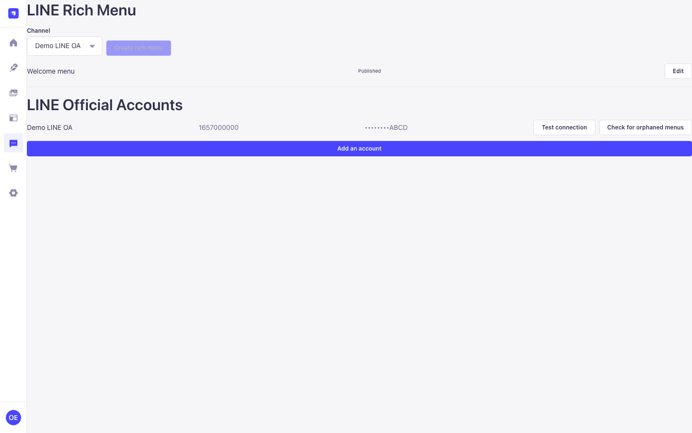
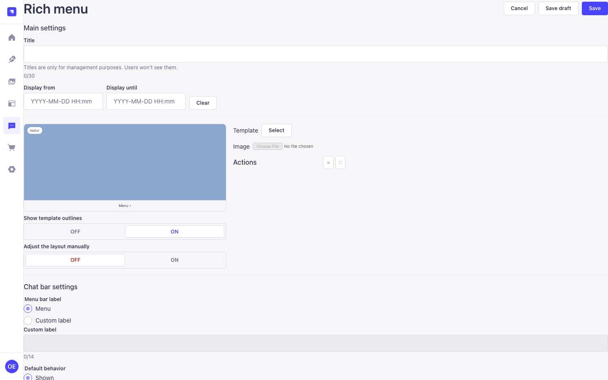
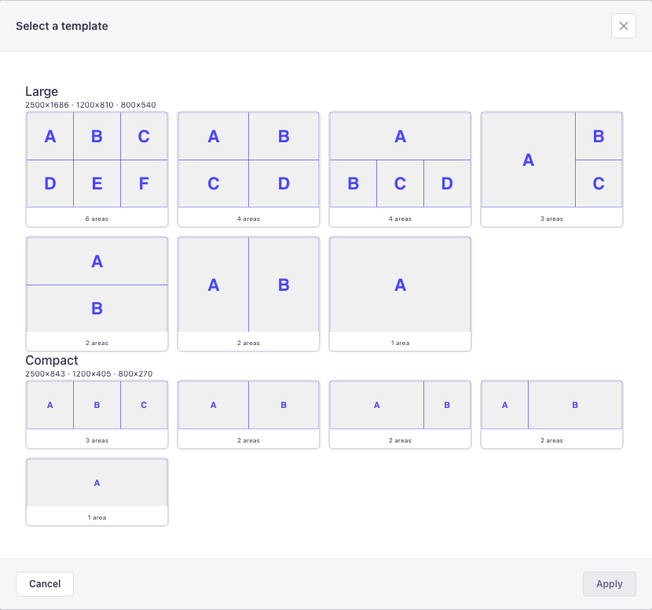
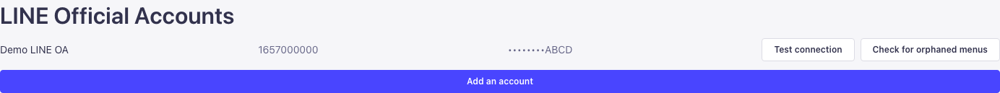

# LINE Rich Menu for Strapi

Design, schedule and publish [LINE](https://developers.line.biz/en/docs/messaging-api/rich-menus-overview/)
rich menus from inside the Strapi admin panel — templates, a drag-and-drop canvas, multi-tab
menus via aliases, scheduled display periods, and a publish path that cleans up after itself
when LINE says no.



## Which package do I install?

| Your Strapi | Package | Status |
|---|---|---|
| 5.x | `strapi-plugin-line-rich-menu` | The one to use |
| 4.25.x | `strapi-plugin-line-rich-menu-v4` | A bridge while you migrate |

Strapi 4 reached **end of life on 30 April 2026** — no more security patches, from anyone,
at any price. The v4 package exists because paying customers are still running 4.25.x, not
because staying on 4 is a reasonable place to build something new. It is npm-only and will
not be listed on the Strapi Marketplace.

```sh
# Strapi 5
npm install strapi-plugin-line-rich-menu

# Strapi 4.25.x
npm install strapi-plugin-line-rich-menu-v4
```

## Configure

`config/plugins.js`

```js
module.exports = ({ env }) => ({
  'line-rich-menu': {
    enabled: true,
    config: {
      // AES-256-GCM key for channel access tokens at rest.
      // Omit it and the plugin derives one from APP_KEYS[0] instead.
      encryptionKey: env('LINE_RM_ENCRYPTION_KEY'),
      scheduler: { enabled: true, cron: '* * * * *', lockTtlMs: 300000 },
    },
  },
})
```

Then give a role the four permissions under **Settings → Roles → Plugins → LINE Rich Menu**:

| Permission | Lets a user |
|---|---|
| `read` | See menus and channels — token previews only, never the token |
| `write` | Create and edit drafts |
| `publish` | Push to LINE, set the default menu, run reconcile |
| `settings` | Add channels and paste access tokens |

`settings` is deliberately separate from `publish`: you can let someone ship menus without
ever letting them see the LINE OA's access token.





## Known limits

Four things worth knowing before you find them the hard way.

**Images are normalised when you save, not when you publish.** A hard-to-compress image
walks the whole size ladder through mozjpeg; several composed areas can together take
**more than 10 seconds** inside one `POST /line-rich-menu/menus`. If you sit behind a
proxy with a short timeout, raise it. Doing this work in a queue would change that
endpoint's contract to `202 Accepted`, which is a 1.x change, not a patch.

**The publish rate limiter is in-memory, per process.** Run three instances and you get
three times the ceiling. That is still far below LINE's own limit, so it protects you from
a stuck retry loop rather than from LINE.

**`aliasId` is unique per channel, enforced in the application, not the database.** Two
simultaneous requests using the same alias can in theory both pass the check. Closing that
properly needs a hand-written unique index.

**Running the scheduler yourself.** Set `scheduler.enabled: false` if you run several
instances or a serverless deployment, then drive it from outside. The endpoint is an admin
route like every other one — no exceptions (that is a security decision, not an oversight),
so it needs an admin API token:

```sh
curl -X POST https://your-strapi.example.com/line-rich-menu/schedules/tick \
  -H "Authorization: Bearer $STRAPI_ADMIN_API_TOKEN" \
  -H 'Content-Type: application/json' -d '{}'
```

## Security

Handles LINE channel access tokens, so we take it seriously: reports go through GitHub's
private vulnerability reporting or `security@fosivo.com`, not a public issue. Strapi 4
reached end of life on 30 April 2026 — running the v4 adapter means accepting Strapi 4's
own unpatched dependency tree, with or without this plugin installed. Full policy, what the
plugin defends against, and what it doesn't: **[SECURITY.md](SECURITY.md)**.

## Licence

Dual-licensed.

- **[AGPL-3.0](LICENSE)** by default. Self-host it, modify it, ship it — but if you run a
  modified version as a network service, the people using that service get its source.
  A Strapi instance is network software, so the AGPL's network clause is the operative one
  here rather than a distribution question.
- **[Commercial](COMMERCIAL-LICENSE.md)** if you need to embed it in a closed-source
  product, run it inside a hosted Strapi you offer to others without publishing your
  changes, or ship it to a client as part of a closed deliverable.

Contact **Fosivo Labs Co., Ltd.** — <https://fosivo.com>

## Support this work

This plugin is free under the AGPL and will stay that way. If it saved you a week, you can
say thanks:

- [GitHub Sponsors](https://github.com/sponsors/captainkie)
- [Buy Me a Coffee](https://buymeacoffee.com/captainkie)
- Or buy a [commercial licence](COMMERCIAL-LICENSE.md) — that funds it directly

Bug reports and reproductions are worth as much as money and take less of it.

## Development

```sh
pnpm install
pnpm test          # 800+ unit tests, no Strapi booted
pnpm build
pnpm e2e:v4        # boots Strapi 4.25.11 against a mock LINE API
pnpm e2e:v5        # boots Strapi 5.52.1 against the same mock
```

`docs/RELEASING.md` has the release checklist. `docs/DEMO.md` has the demo deployment.
