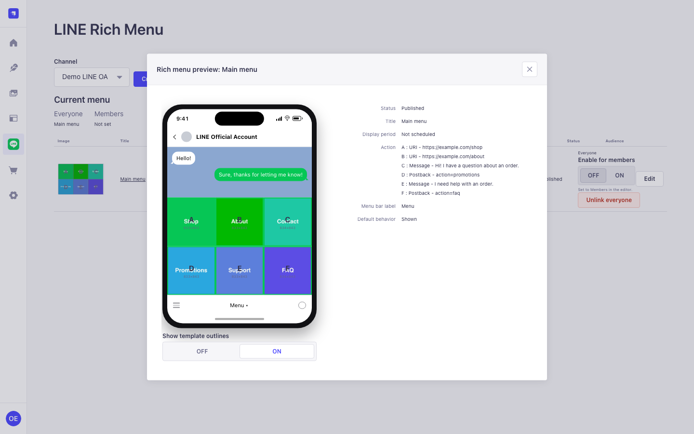

<h1 align="center">📱 LINE Rich Menu for Strapi</h1>

<p align="center">
  <b>Design, schedule and publish LINE rich menus without leaving the Strapi admin panel.</b><br/>
  Templates, a drag-and-drop canvas, multi-tab menus via aliases, scheduled display periods,
  and a publish path that cleans up after itself when
  <a href="https://developers.line.biz/en/docs/messaging-api/rich-menus-overview/">LINE</a>
  says no. Menus can target everyone or just your LINE members, linked and unlinked for you in the
  background. One plugin, <b>Strapi 4 and Strapi 5</b>.
</p>

<p align="center">
  <a href="https://line-rich-menu.fosivo.com/admin"></a>
  <a href="https://github.com/captainkie/strapi-plugin-line-rich-menu/actions/workflows/ci.yml"></a>
  <a href="./LICENSE"></a>
  
  
  <a href="https://github.com/sponsors/captainkie"></a>
  <a href="https://buymeacoffee.com/captainkiez"></a>
</p>

<p align="center">
  
</p>

---

## Try it without installing anything

**<https://line-rich-menu.fosivo.com/admin>** — a real Strapi 5 with the plugin installed.

```
demo@fosivo.com
DemoRichMenu2026!
```

Publishing there talks to a copy of `tools/line-mock` running inside the same container, not to
LINE, so nothing you do reaches a real Official Account — press every button.

That login is a **restricted account**, not the superadmin Strapi hands to whoever registers
first. It holds every permission this plugin defines and nothing else — so you can build,
publish and delete menus, upload images and manage the demo's LINE channel, while Strapi's own
settings, the Content-Type Builder, the admin user list and the API tokens stay out of reach.
If you are deploying your own demo, `examples/v5-app/scripts/demo-restrict.mjs` is what sets
that up, and [docs/DEMO.md](docs/DEMO.md) explains which permission is safe to hand out and
which one depends on whether your demo talks to a real Official Account.

Two things to know before you judge it. The first request after a quiet spell takes about a
minute: it runs on a free instance that sleeps, and the cold start is the hosting, not the
plugin. And uploaded images live on an ephemeral disk, so they disappear whenever the demo
redeploys — the menus stay, the artwork does not.

## Which package do I install?

| Your Strapi | Package | Status |
|---|---|---|
| 5.x | `strapi-plugin-line-rich-menu` | The one to use |
| 4.25.x | `strapi-plugin-line-rich-menu-v4` | A bridge while you migrate |

Strapi 4 reached **end of life on 30 April 2026** — no more security patches, from anyone,
at any price. The v4 package exists because paying customers are still running 4.25.x, not
because staying on 4 is a reasonable place to build something new. It is npm-only and will
not be listed on the Strapi Marketplace.

```sh
# Strapi 5
npm install strapi-plugin-line-rich-menu

# Strapi 4.25.x
npm install strapi-plugin-line-rich-menu-v4
```

## Configure

`config/plugins.js`

```js
module.exports = ({ env }) => ({
  'line-rich-menu': {
    enabled: true,
    config: {
      // AES-256-GCM key for channel access tokens at rest.
      // Omit it and the plugin derives one from APP_KEYS[0] instead.
      encryptionKey: env('LINE_RM_ENCRYPTION_KEY'),
      scheduler: { enabled: true, cron: '* * * * *', lockTtlMs: 300000 },
    },
  },
})
```

Then give a role the four permissions under **Settings → Roles → Plugins → LINE Rich Menu**:

| Permission | Lets a user |
|---|---|
| `read` | See menus and channels — token previews only, never the token |
| `write` | Create and edit drafts |
| `publish` | Push to LINE, set the default menu, run reconcile |
| `settings` | Add channels and paste access tokens |

`settings` is deliberately separate from `publish`: you can let someone ship menus without
ever letting them see the LINE OA's access token.

From here the **[usage guide](docs/USAGE.md)** walks through connecting an Official Account and
shipping your first menu.

**Your menus, per LINE account.** The same table LINE's own console shows: a thumbnail of the
real layout with your artwork behind it, every area's action, the display period, and the
status — so you can tell two menus apart without opening either.


**Look before you edit.** Click a title for a read-only preview — the menu inside a LINE chat
on the left, its settings on the right, area outlines on a toggle.



**Pick a layout.** Seven large and five compact templates, each showing the canvas sizes LINE
accepts for it, or turn on *Adjust the layout manually* and drag the areas yourself.


**Connect an account.** Channels live on their own page, away from the menus — test the
connection before you save it, and check for rich menus that exist on LINE but not here. The
access token is masked to its last four characters everywhere it appears; nothing on these
screens ever decrypts it.


## Documentation

| | |
|---|---|
| **[Usage guide](docs/USAGE.md)** | Connect an account, build a menu, schedule it, publish it, and fix it when LINE says no |
| **[How it is built](docs/SPEC.md)** | The design and the reasoning — the two seams that let one plugin run inside two incompatible Strapi versions |
| **[Security](SECURITY.md)** | What is defended, what is not, how to report a vulnerability |
| **[Running the demo](docs/DEMO.md)** | Deploying this yourself, and the traps that cost us time |
| **[Releasing](docs/RELEASING.md)** | The checklist behind a published version |

## Known limits

Five things worth knowing before you find them the hard way.

**Images are normalised when you save, not when you publish.** A hard-to-compress image
walks the whole size ladder through mozjpeg; several composed areas can together take
**more than 10 seconds** inside one `POST /line-rich-menu/menus`. If you sit behind a
proxy with a short timeout, raise it. Doing this work in a queue would change that
endpoint's contract to `202 Accepted`, which is a 1.x change, not a patch.

**The publish rate limiter is in-memory, per process.** Run three instances and you get
three times the ceiling. That is still far below LINE's own limit, so it protects you from
a stuck retry loop rather than from LINE.

**`aliasId` is unique per channel, enforced in the application, not the database.** Two
simultaneous requests using the same alias can in theory both pass the check. Closing that
properly needs a hand-written unique index.

**Running the scheduler yourself.** Set `scheduler.enabled: false` if you run several
instances or a serverless deployment, then drive it from outside. The endpoint is an admin
route like every other one — no exceptions (that is a security decision, not an oversight),
so it needs an admin API token:

```sh
curl -X POST https://your-strapi.example.com/line-rich-menu/schedules/tick \
  -H "Authorization: Bearer $STRAPI_ADMIN_API_TOKEN" \
  -H 'Content-Type: application/json' -d '{}'
```

**The editor cannot show you the image a saved menu already has.** `GET /menus/:id` returns
`imageFileId` and no URL, and a browser file input cannot be pre-filled by any site, so
reopening a saved menu shows an empty image field even though the menu has an image. Saving
without touching it keeps the existing image — unless you switch to a template with a
different canvas size, which drops it, because it no longer fits. Nothing is lost silently;
it just looks emptier than it is.

## Security

Handles LINE channel access tokens, so we take it seriously: reports go through GitHub's
private vulnerability reporting or `security@fosivo.com`, not a public issue. Strapi 4
reached end of life on 30 April 2026 — running the v4 adapter means accepting Strapi 4's
own unpatched dependency tree, with or without this plugin installed. Full policy, what the
plugin defends against, and what it doesn't: **[SECURITY.md](SECURITY.md)**.

## Authors

A product of **[Fosivo Labs Co., Ltd.](https://fosivo.com)**, built by
**Narenrit Hadsadintorn** ([@captainkie](https://github.com/captainkie)) together with
**Claude** (Anthropic) as an AI pair-builder.

That second name is not decoration, and it is recorded rather than implied: **Claude appears in
the `contributors` field of both published packages**, and every commit it worked on carries a
`Co-Authored-By` trailer, so `git log` shows who wrote what without anyone having to remember.

The plugin's shape — one injected `UIPort` carrying everything version-specific, so a single
React layer renders identically against two incompatible design systems — was argued out between
the two of them. So was the habit that found most of the defects worth naming in this history:
**break every guard on purpose before believing it.** Fifteen guards in this repository turned out
to be green while enforcing nothing, including one that reported files missing that were sitting
in the archive it had just listed. None of them were found by reading the code.

## Licence

**[Apache-2.0](LICENSE).** Self-host it, embed it in a closed-source product, ship it inside
a hosted Strapi you offer to others without publishing your changes — all granted by default,
no separate commercial terms needed. §3 of the licence also grants you an explicit patent
licence from every contributor, which this plugin's previous licence did not.

The plugin bundles the real LINE app icon to identify the integration it provides — see
**[THIRD_PARTY_NOTICES.md](THIRD_PARTY_NOTICES.md)** for that trademark's owner and terms;
it is not covered by the Apache-2.0 grant above.

Contact **Fosivo Labs Co., Ltd.** — <https://fosivo.com>

## Support this work

This plugin is free under Apache-2.0 and will stay that way. If it saved you a week, you can
say thanks:

- [GitHub Sponsors](https://github.com/sponsors/captainkie)
- [Buy Me a Coffee](https://buymeacoffee.com/captainkiez)

Bug reports and reproductions are worth as much as money and take less of it.

## Development

```sh
pnpm install
pnpm test          # 800+ unit tests, no Strapi booted
pnpm build
pnpm e2e:v4        # boots Strapi 4.25.11 against a mock LINE API
pnpm e2e:v5        # boots Strapi 5.52.1 against the same mock
```

`docs/RELEASING.md` has the release checklist. `docs/DEMO.md` has the demo deployment.
